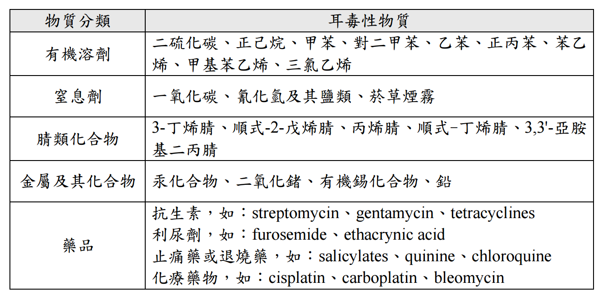

## 講師簡介 {.custom}

- 姓名：何明信
- 學歷：成大環醫所 、職安衛技師
- 經歷：檢查員30年 (製造、危機設、營造、化工**職衛科**、專委)
- 現職：114年退休
- E-mail：msho7336959\@gmail.com

# 一、個人防護具概念

## 參考資料

- **(歐盟委員會)** European Commission. (2024, October). *PPE Regulation (EU) 2016/425 guidelines: Guide to application of Regulation (EU) 2016/425 of the European Parliament and of the Council of 9 March 2016 on personal protective equipment* (4th ed.). Directorate-General for Internal Market, Industry, Entrepreneurship and SMEs.

- **(愛爾蘭衛生安全局)** Health and Safety Authority. (2015). *A guide to non-respiratory personal protective equipment (PPE) for use with chemical agents in the workplace*. Health and Safety Authority.

- **(英國衛生安全局)** Health and Safety Executive. (2026). *Using personal protective equipment (PPE) to control risks at work* (INDG174). HSE.

- **(國際勞工組織)** International Labour Organization. (2021). *Personal protective equipment* (Publication No. WCMS 823730). Department of Inspection for Factories and Establishments.

- **(美國 OSHA)** Occupational Safety and Health Administration. (2023). *Personal protective equipment* (OSHA Publication No. 3151-02R). U.S. Department of Labor.

- **(澳洲安全工作局)** Safe Work Australia. (2025, July). *Is your personal protective equipment keeping you safe?* \[Infographic\]. Safe Work Australia.

- **(美國華盛頓大學 EH&S)** University of Washington Environmental Health & Safety. (2022, February). *Guidelines for personal protective equipment (PPE)*. University of Washington.

## 職安衛定位與基本概念 1

#### 雇主與勞工都需要學習如何正確選擇並使用**個人防護具（PPE）。**

#### 先危害暴露評估，再進行個人防護具選用。

- **第一步：危害與暴露評估**

  - 先對工作場所與作業流程進行系統化的危害評估。包含物理、化學、生物、人因、社會心理等。

  - **釐清暴露條件**：需詳細確認**「誰會暴露」、「暴露於何種危害」以及「暴露時間長短與濃度/強度」**。

  - **確認控制階層**：評估過程中須先確認是否能透過消除、替代、工程控制或管理控制來降低風險；PPE 僅能作為上述措施無法完全消除風險時的**最後一道防線。**

## 職安衛定位與基本概念 2

- **第二步：防護具選用**

  - **匹配危害與防護等級**：評估確定需要 PPE 後，根據危害類型與所需的防護程度，選用**符合相應標準（如 CE、ANSI、CSA 或 EN）**的防護具。

  - **考量個體合身性與舒適度**：選擇適合勞工（Fit），確保佩戴舒適，勿擅自修改結構。

  - **檢查相容性**：當多種 PPE 需同時佩戴時（如防護眼鏡、安全帽與耳罩或呼吸器），必須確保彼此相容，不會因為疊加佩戴而破壞防護效果。

## 職安衛定位與基本概念 3

#### 選定合適的個人防護具（PPE）後，**教育訓練**是確保防護具能真正發揮預期效能的關鍵環節。

各機構規範強調，教育訓練並非一次性的活動，而是包含**初次使用**、**特定觸發條件下的再訓練(MOC)、緊急應變**以及**定期複訓**。

- **第三步 教育訓練**

  - 防止防護失效與「虛假安全感」。

  - 避免二次污染與操作傷害。

  - **明確防護具的極限（Limitations）**

    - 防護具並非萬能，任何 PPE 都有其適用防護範圍與耐用壽命（例如防毒面具濾毒罐吸附飽和、手套化學滲透時間等）。

    - 訓練能讓勞工清楚了解裝備在何種情境下無法提供保護。

  - 確保即時檢查與維護

  - 符合法規要求與紀錄備查 ([設施規則277條](https://laws.mol.gov.tw/FLAW/FLAWDOC01.aspx?id=FL015021&flno=277))

## 職安衛定位與基本概念 4

#### 教育訓練應涵蓋的核心內容

- **危害認知**：作業環境中存在哪些危害，以及為何需要佩戴 PPE。

- **佩戴時機與種類**：明確何時必須佩戴防護具，以及針對特定作業應選用哪種防護具。

- **穿脫、調整與合身度**：如何正確穿上（Don）、調整至密合且舒適（Fit）、佩戴以及安全脫下（Doff）。

- **性能與局限性**：防護具的防護極限及預期使用壽命。

- **檢查與瑕疵識別**：每次使用前如何檢查裝備是否裂開、變形、老化或損壞。

- **清潔、消毒、維護與存放**：使用後的清潔方式、消毒程序、存放環境（如避免陽光直射）及拋棄規範。

- **製造商指引與警告**：遵照原廠說明書中的具體使用警告與備品更換規範。

## 職安衛定位與基本概念 5

#### 維護

- **嚴格遵循製造商手冊（Manufacturer's Instructions）**：防具的佩戴、調整、儲存、清潔、消毒及維護，均須完全依照製造商提供的說明書執行。

- **維護作業實施「分級管理」**：

  - **簡易維護**：經適當指導後，可由使用者自行處理（如更換鞋帶、清洗護目鏡鏡片）。

  - **專業/高風險設備維護**：針對高風險或結構複雜的裝備（如高空防墜安全帶 harness、呼吸防護具），檢查與維修必須由受過特別訓練的專人執行，必要時須**寄回原廠或送交製造商指定的專業機構**維修。

- **使用原廠替換零件**：保養更換耗材（如濾毒罐、面罩配件）時，必須使用原廠或符合製造商規範的指定替換零件，不得使用未經認可的替代品。

- **每日檢查與定期專業檢視**：勞工每次使用前應檢查防具是否破損或過期；雇主應安排專人進行定期全面檢查。

- **注意退役指標與使用壽命（Obsolescence & Expiry）**：注意防具的退役標示或製造商建議的最大清洗次數。若防具出現裂痕、變色、老化、破損或遭受嚴重污染，應立即淘汰更換，切勿繼續使用損壞的防具。

## 職安衛定位與基本概念 6

#### 選用與維護過程中，各機構明確建議諮詢專家、製造廠商。

- **向供應商/製造商尋求選用指引**：選用 PPE 時，應主動向供應商或製造商說明具體作業環境等，請其推薦合適的產品型號。

- **善用安全資料表（SDS）與線上選用工具**：處理化學品時，應參照化學品 SDS 以及製造商提供的化學防護資料（如穿透時間、滲透率數據）或線上選用工具來篩選適當的手套與防護服。

- **複雜風險諮詢專門顧問/EHS 部門**：遇到複雜作業情境、高風險危害或無法確定控制措施時，應尋求專業安全衛生顧問、職業安全部門（EH&S）的協助。

## 職安衛定位與基本概念 7

#### 綜合國際勞工組織（ILO）、美國 OSHA、歐盟 EU-OSHA、英國 HSE、愛爾蘭 HSA 及華盛頓大學 EH&S 等機構指引，整理危害類型與對應之個人防護具（PPE）如下：

+------------+----------------------------------+---------------------------+------------------------------------------------------------------+
| 部位       | 危害情境                         | 對應PPE                   | 關鍵防護特性與注意事項                                           |
+============+==================================+===========================+==================================================================+
| **頭部**   | 物體飛落、高空墜物、碰撞         | **硬帽 / 安全帽**         | 具衝擊吸收與穿刺防護                                             |
|            |                                  |                           |                                                                  |
|            |                                  |                           | • **Class A**：提供基礎電壓防護（至 2,200V）                     |
|            |                                  |                           |                                                                  |
|            |                                  |                           | • **Class B**：提供高壓電擊防護（至 20,000V）                    |
|            |                                  |                           |                                                                  |
|            |                                  |                           | • **Class C**：僅具抗衝擊性，**無絕緣防護**                      |
+------------+----------------------------------+---------------------------+------------------------------------------------------------------+
|            | 空間狹窄、頭部刮傷或輕微碰撞     | **防撞帽**                | 輕量塑膠材質，僅防輕微碰撞刮傷，**不可代替安全帽防範高空墜物**。 |
+------------+----------------------------------+---------------------------+------------------------------------------------------------------+
|            | 衛生防塵、生物危害、捲入機械風險 | **蓬鬆手術帽 / 髮網**     | 包覆頭髮防止污染作業環境或避免頭髮被運轉機械捲入。               |
+------------+----------------------------------+---------------------------+------------------------------------------------------------------+
|            | 特殊電壓弧光危害                 | **防焰帽 (FR Balaclava)** | 提供頭頸部高風險電氣防弧光防護。                                 |
+------------+----------------------------------+---------------------------+------------------------------------------------------------------+

## 一、職安衛定位與基本概念 7

+------------+------------+------------+---------------------------+
| 部位       | 危害情境   | 對應PPE    | 關鍵防護特性與注意事項    |
+============+============+============+===========================+

+------------+----------------------------------------------+-------------------------------+----------------------------------------------------------------------------------------------+
|            |                                              |                               |                                                                                              |
+============+==============================================+===============================+==============================================================================================+
| **眼面**   | 衝擊、飛濺顆粒、碎屑                         | **安全眼鏡**                  | 需符合 ANSI Z87.1 等標準，採用抗衝擊聚碳酸酯鏡片；若有視力矯正需求可佩戴套鏡或處方安全眼鏡。 |
|            |                                              |                               |                                                                                              |
|            |                                              | *(需具側邊防護屏)*            |                                                                                              |
+------------+----------------------------------------------+-------------------------------+----------------------------------------------------------------------------------------------+
|            | 化學品液體噴濺、酸鹼危害、有害粉塵/氣體      | **護目鏡**                    | • **間接通氣型**：可防液體噴濺與粉塵，防止化學品直接進入。                                   |
|            |                                              |                               |                                                                                              |
|            |                                              | *(間接通氣型 / 無通氣型)*     | • **無通氣型 (Non-Vented)**：完全密封，可防氣體、蒸氣與細微霧滴。                            |
+------------+----------------------------------------------+-------------------------------+----------------------------------------------------------------------------------------------+
|            | 大面積化學品噴濺、高溫熔融金屬、飛濺劇烈顆粒 | **面罩 / 防護面盾**           | 完整遮蔽臉部；**須搭配安全眼鏡或護目鏡共同佩戴**以達完整眼面防護。                           |
+------------+----------------------------------------------+-------------------------------+----------------------------------------------------------------------------------------------+
|            | 焊接、乙炔切割、強光/有害光線 (UV/紅外線)    | **焊接面罩 / 遮光濾光護目鏡** | 具特定暗度濾光鏡片（Tinted/Filter lenses），防範強光、火花及有害輻射。                       |
+------------+----------------------------------------------+-------------------------------+----------------------------------------------------------------------------------------------+
|            | 實驗室化學噴濺、放射線、爆炸衝擊             | **桌上型防護屏 / 防爆屏**     | 壓克力或防彈材質擋板，針對 Beta/Gamma 射線、化學濺灑或微型爆炸提供物理屏障。                 |
+------------+----------------------------------------------+-------------------------------+----------------------------------------------------------------------------------------------+

## 職安衛定位與基本概念 7

+------------+------------+------------+---------------------------+
| 部位       | 危害情境   | 對應PPE    | 關鍵防護特性與注意事項    |
+============+============+============+===========================+

+----------------+--------------------------------------+--------------------------------+----------------------------------------------------------------------------+
|                |                                      |                                |                                                                            |
+================+======================================+================================+============================================================================+
| **手部與手臂** | 割傷、磨損、刺穿、高低溫、極端熱輻射 | **抗切割/耐磨手套、皮手套**    | 皮革常用於防範乾熱與火焰；特殊金屬編織手套可用於高割傷風險作業。           |
+----------------+--------------------------------------+--------------------------------+----------------------------------------------------------------------------+
|                | 化學品侵蝕、腐蝕性液體、溶劑         | **耐化學手套**                 | 必須根據化學品種類（參照 SDS）、化學透出時間與滲透率數據選用特定材質手套。 |
|                |                                      |                                |                                                                            |
|                |                                      | *(如丁晴、氯丁橡膠、塑膠材質)* |                                                                            |
+----------------+--------------------------------------+--------------------------------+----------------------------------------------------------------------------+
|                | 電擊風險（活線作業/高壓電）          | **橡膠絕緣手套**               | 須符合 ASTM D120 標準，並視需要搭配手臂絕緣袖套（Rubber Sleeves）。        |
+----------------+--------------------------------------+--------------------------------+----------------------------------------------------------------------------+
|                | 大面積液體濺灑、生物危害             | **防護袖套**                   | 覆蓋手腕至手臂，防止液體或有害顆粒接觸皮膚。                               |
+----------------+--------------------------------------+--------------------------------+----------------------------------------------------------------------------+

## 職安衛定位與基本概念 7

+------------+------------+------------+---------------------------+
| 部位       | 危害情境   | 對應PPE    | 關鍵防護特性與注意事項    |
+============+============+============+===========================+

+----------------+-------------------------------------------+--------------------------------+--------------------------------------------------------------+
|                |                                           |                                |                                                              |
+================+===========================================+================================+==============================================================+
| **足部與腿部** | 重物壓傷、足背撞擊、尖銳物刺穿            | **鋼頭安全鞋**                 | 防範重物跌落壓傷腳趾與足背結構。                             |
|                |                                           |                                |                                                              |
|                |                                           | **蹠骨護具**                   |                                                              |
+----------------+-------------------------------------------+--------------------------------+--------------------------------------------------------------+
|                | 油污、光滑地面滑倒、化學品濺灑            | **防滑鞋/耐化學長靴**          | 鞋底採特殊紋路防滑，耐油且可耐腐蝕性化學液體浸泡。           |
+----------------+-------------------------------------------+--------------------------------+--------------------------------------------------------------+
|                | 靜電引爆風險、電氣危害                    | **防靜電鞋 / 導電鞋 / 絕緣鞋** | 在易燃易爆環境佩戴防靜電/導電鞋，高壓作業則採用絕緣安全鞋。  |
+----------------+-------------------------------------------+--------------------------------+--------------------------------------------------------------+
|                | 高壓水柱切割、高草叢/植物毒素或高切割風險 | **護脛/護膝**                  | 保護脛骨免受高壓水柱衝擊或鋸切傷害，護膝則減少跪姿作業磨損。 |
+----------------+-------------------------------------------+--------------------------------+--------------------------------------------------------------+

## 職安衛定位與基本概念 7

+------------+------------+------------+---------------------------+
| 部位       | 危害情境   | 對應PPE    | 關鍵防護特性與注意事項    |
+============+============+============+===========================+

+------------+------------------------------------+---------------------------+--------------------------------------------------------------------+
|            |                                    |                           |                                                                    |
+============+====================================+===========================+====================================================================+
| **身體**   | 化學液體噴濺、高壓滲透、酸鹼腐蝕   | **防化服 / 耐化學圍裙**   | 採橡膠、氯丁橡膠或塑料等化學不透水材質，阻隔危險化學品接觸軀干。   |
+------------+------------------------------------+---------------------------+--------------------------------------------------------------------+
|            | 火焰、高熱、電弧光閃絡 (Arc Flash) | **抗防焰服**              | 具阻燃與抗電弧特性，高溫或電氣作業時保護全身皮膚不被灼傷。         |
+------------+------------------------------------+---------------------------+--------------------------------------------------------------------+
|            | 生物危害、血液與體液感染風險       | **抗滲透隔離衣 / 實驗衣** | 具三層結構或抗液體滲透材質，防止血液及潛在感染性物質穿透接觸皮膚。 |
+------------+------------------------------------+---------------------------+--------------------------------------------------------------------+
|            | 粉塵、輕微液體濺灑                 | **拋棄式防塵連身服**      | 紙質纖維等輕便材質，防護微塵與輕度濺灑。                           |
+------------+------------------------------------+---------------------------+--------------------------------------------------------------------+
|            | 夜間/高交通風險環境                | **高可視性反光背心/衣服** | 提供高對比度色彩與反光條，確保人員在低光環境中容易被識別。         |
+------------+------------------------------------+---------------------------+--------------------------------------------------------------------+

## 職安衛定位與基本概念 7

+------------+------------+------------+---------------------------+
| 部位       | 危害情境   | 對應PPE    | 關鍵防護特性與注意事項    |
+============+============+============+===========================+

+------------------+------------------------+------------------------------------------+------------------------------------------------------------------------------------------------------------------------+
|                  |                        |                                          |                                                                                                                        |
+==================+========================+==========================================+========================================================================================================================+
| **高空防墜系統** | 高空作業、存在墜落危害 | **個人防墜落系統 (PFPS)**                | 包括防墜落（Fall Arrest）、工作定位（Positioning）及限制移動（Travel Restraint）等系統，防止勞工跌落或減緩墜落衝擊力。 |
|                  |                        |                                          |                                                                                                                        |
|                  |                        | *(含全身式安全帶、繫繩、防墜器與錨定點)* |                                                                                                                        |
+------------------+------------------------+------------------------------------------+------------------------------------------------------------------------------------------------------------------------+

+-----------+----------------------------------------------------+-------------------------+--------------------------------------------------------------------------------------------+
|           |                                                    |                         |                                                                                            |
+===========+====================================================+=========================+============================================================================================+
| **聽力**  | 高分貝噪音（如機械加工、磨削、氣動工具、切割作業） | **耳塞 (Earplugs)**     | 依據降噪評級（NRR）選用：                                                                  |
|           |                                                    |                         |                                                                                            |
|           |                                                    | **耳罩 (Earmuffs)**     | • **耳塞**：深入耳道，防護佳且成本低。                                                     |
|           |                                                    |                         |                                                                                            |
|           |                                                    | **管道帽/半插入式耳塞** | • **管道帽**：適合髒污手部快速穿脫佩戴。                                                   |
|           |                                                    |                         |                                                                                            |
|           |                                                    |                         | • **耳罩**：配戴方便，但若與眼鏡同時佩戴可能破壞密合度降低效果。極高噪音環境可採雙重防護。 |
+-----------+----------------------------------------------------+-------------------------+--------------------------------------------------------------------------------------------+
| **呼吸**  | 有害粉塵、煙霧、毒氣、化學蒸氣、缺氧環境           | **過濾式呼吸器**        | • **過濾式**：利用濾材/濾毒罐過濾環境空氣（如簡易防塵口罩、防毒面具）。                    |
|           |                                                    |                         |                                                                                            |
|           |                                                    | **供氣式呼吸器**        | • **供氣式/自給式**：獨立提供清潔空氣，適用於缺氧環境或高濃度毒氣環境。                    |
+-----------+----------------------------------------------------+-------------------------+--------------------------------------------------------------------------------------------+

# 二、職安衛法規規定

## 通則

[設施規則第 277 條](https://laws.mol.gov.tw/FLAW/FLAWDOC01.aspx?id=FL015021&flno=277) 雇主供給勞工使用之個人防護具或防護器具，應依下列規定辦理：

一、保持**清潔**，並予必要之消毒。

二、經常**檢查，保持其性能**，不用時並妥予保存。

三、防護具或防護器具應準備**足夠使用之數量**，個人使用之防護具應置備 與作業勞工人數相同或以上之數量，並以**個人專用為原則**。

四、對勞工有感染疾病之虞時，應置備個人專用防護器具，或作預防感染 疾病之措施。

## 特殊規定 - 聽力防護

設施規則 [第 300-1 條](https://laws.mol.gov.tw/FLAW/FLAWDOC01.aspx?id=FL015021&flno=300-1)

雇主對於勞工八小時日時量平均音壓級超過八十五分貝或暴露劑量超過百 分之五十之工作場所，應採取下列聽力保護措施，作成執行紀錄並留存三 年：

一、噪音監測及暴露評估。

二、噪音危害控制。

三、防音防護具之選用及佩戴。

四、聽力保護教育訓練。

五、健康檢查及管理。

六、成效評估及改善。

前項聽力保護措施，事業單位勞工人數達一百人以上者，雇主應依作業環 境特性，訂定聽力保護計畫據以執行；於勞工人數未滿一百人者，得以執 行紀錄或文件代替。

## 特殊規定 - 聽力防護1

[勞工聽力保護措施辦理原則](https://laws.mol.gov.tw/FLAW/FLAWDAT01.aspx?id=FL106213) 

- 協助雇主落實《職業安全衛生設施規則》第 300 條之 1 規定所提供的行政指導。

- 適用對象與事業單位規模規定

  - **適用噪音作業**：勞工噪音暴露工作日 8 小時日時量平均音壓級（TWA-8hr）**超過 85 分貝 (dBA)** 或**暴露劑量超過 50%** 之作業。

  - **實施管道與事業單位規模門檻**：

    - 事業單位勞工人數達 100 人以上者：雇主應依作業環境特性，訂定書面**「聽力保護計畫」**據以執行，內容須涵蓋實施目的、對象、量化目標、執行流程、權責分工及期程。

    - 勞工人數未滿 100 人者：得以執行紀錄或文件代替聽力保護計畫。

## 特殊規定 - 聽力防護2

#### 聽力保護計畫

1.  **噪音監測及暴露評估**

- **定期監測**：對TWA-8hr 達 **85 dBA 以上**之作業場所，應依《勞工作業環境監測實施辦法》**每 6 個月至少實施噪音監測 1 次**。若引進或修改製程、作業程序、材料及設備而有增加暴露風險之虞者，應即實施監測評估。

- **不定期監測**：遇到勞工抱怨、工程改善後等情境，應建立即時監測機制。

- **暴露時態掌握**：運用噪音量測儀器建立噪音分貝時量變化圖譜，確認噪音峰值與特性，作為控制措施之參考。

## 特殊規定 - 聽力防護3

2.  **噪音危害控制**

- **法定量值與控制階層**

  - 工作場所機械設備發生聲音**超過 90 dBA** 時，雇主應採取**工程控制**或**減少暴露時間**，且**任何時間不得暴露於峰值超過 140 dBA 之衝擊性噪音或 115 dBA 之連續性噪音**。

  - 應優先評估噪音工程控制方法（如源頭降噪、傳播路徑隔音/吸音/阻絕），必要時實施暴露時間行政管理（如作業輪替、工作調整輪調、改變作業程序）。

- **休息場所規範**：雇主應提供勞工適當之休息場所，該場所噪音**以不超過 80 dBA 為原則**。

## 特殊規定 - 聽力防護4

3.  **防音防護具之選用及佩戴**

- **選用標準與效果要求**：選用符合國家或國際標準之防音防護具（如耳塞、耳罩），並評估防音效果（如美國 NRR、歐盟/英國 SNR 等計算方法）。防護效果須能將勞工 TWA-8hr 降至 **85 dBA 以下**（或暴露劑量至 **50% 以下**），且**不致影響溝通或警告聲響**。

- **綜合考量因素**：選用時應一併考量工作負荷、穿戴時間、異常溫濕度、作業溝通及佩戴眼鏡等因素。

- **管理與紀錄**：雇主應訂定防音防護具之**清潔消毒、保存、性能檢查維護、領用及更換**機制，並留存紀錄。

## 特殊規定 - 聽力防護5

4\. **聽力保護教育訓練**

- **結合職安訓練**：應於辦理一般安全衛生教育訓練或在職教育訓練時，納入聽力保護課程，並留存訓練紀錄。

- **訓練主題範疇**：至少應涵蓋噪音對聽力之危害、容許暴露劑量、環境監測配合事項、危害控制配合事項、防護具佩戴方法、健康檢查與管理配合事項等。

5\. **健康檢查及管理**

- **健康檢查頻率**：TWA-8hr 達 **85 dBA 以上**之勞工，除實施一般體格檢查外，應實施噪音作業**特殊體格檢查**，並**每年實施 1 次噪音作業特殊健康檢查**。

- **聽力衰退分析與校正**：分析勞工個人歷年聽力損失變化，若**高頻音（3K, 4K, 6K Hz）或低頻音（0.5K, 1K, 2K Hz）平均聽力閾值衰減達 10 dB 以上**，或 **4K Hz / 6K Hz 聽力閾值呈現惡化趨勢**，應評估原因並持續改善（評估時可依國人性別年齡常模校正老化影響）。

- **健康管理分級處置**：若檢查結果屬於**第 3 級管理以上者**，雇主應請職業醫學科專科醫師、從事勞工健康服務之護理人員等配合訪視現場，提出改善與預防措施建議。

6\. **成效評估及改善**

- 雇主**每年應至少評估聽力保護措施成效 1 次**，據以修正計畫及採行措施，確保防護機制能有效執行並符合實際需求。

## 特殊規定 - 聽力防護6

1.  **耳毒性物質（Ototoxic Substances）協同危害防範**：

    - 勞工若**同時暴露於噪音與耳毒性化學物質**（如有機溶劑甲苯/苯乙烯、窒息劑一氧化碳、腈類化合物、重金屬鉛/汞、特定藥物等），兩者會引發**協同或加成效應**，造成更嚴重的聽力損傷。雇主應將耳毒性物質一併納入風險評估與暴露管理中。

    - {.lightbox}

2.  **紀錄留存年限**：

    - 雇主對於所採取之各項聽力保護措施執行紀錄（如監測、訓練、防護具管理等），**應妥善留存 3 年**。

## 特殊規定 - 聽力防護7

#### 推薦參考資料 (自行練功)

1.  [勞工聽力保護計畫參考指引(第五版)](https://results.ilosh.gov.tw/iLosh/wSite/ct?xItem=40656&ctNode=325&mp=3)

2.  [防護具選用技術手冊—防音防護具](https://results.ilosh.gov.tw/iLosh/wSite/ct?xItem=12573&ctNode=325&mp=3)

## 特殊規定 - 呼吸防護

## 特殊規定 - 墜落防護
