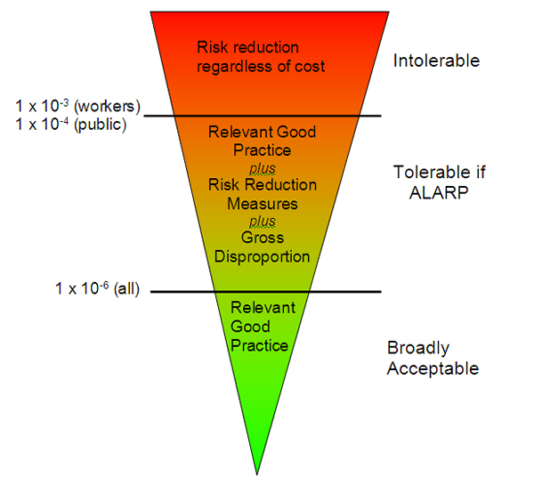
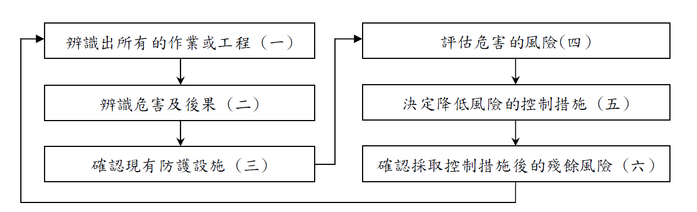
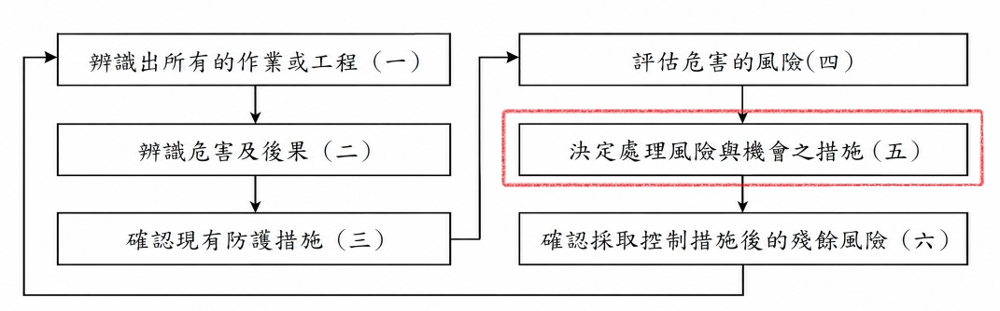
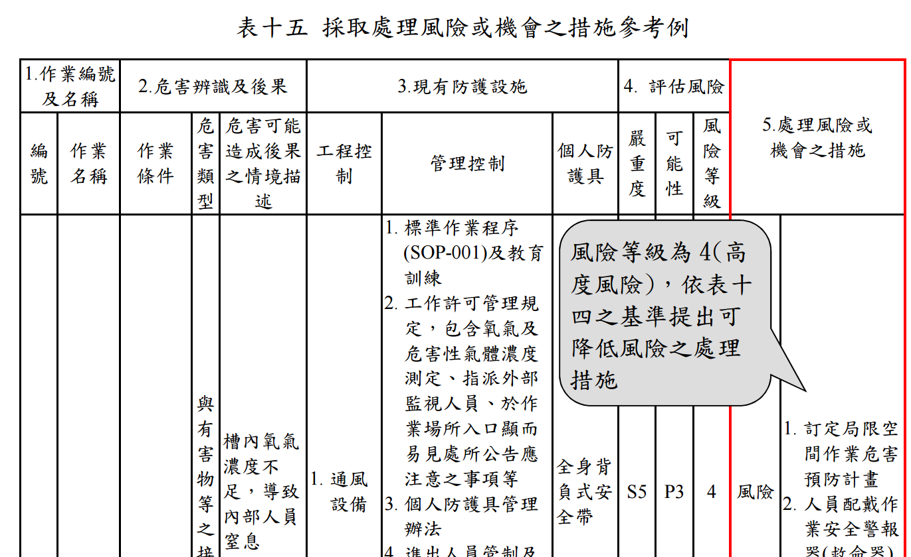

## 講師簡介

- 姓名：何明信

- 學歷：成大環醫所 、職安衛技師

- 經歷：檢查員30年 (製造、危機設、營造、化工職衛科、專委)

- 現職：114年退休

- E-mail：msho7336959\@gmail.com

# 0. 基礎技能

- **查找法規** - [勞動法令查詢系統](https://laws.mol.gov.tw/index.aspx)

- **運用簡單AI** - 學習(效率+效能)

- **練習**

  1.  施工風險評估 - 職安法規有規定？

  2.  法規內容整理學習 - [Gemini Notebook](https://notebook.google.com/) ？

      - **試試** [風險評估指引](https://www.osha.gov.tw/48110/48713/48735/212505/post) (民國 115 年 9 月 18 日修正)

# 1.教材內容

## 壹、前言

- 人類生活環境到處存有危害因素：能造成傷亡、財物損壞或健康影響。
- **風險評估**是現代安全及健康管理的基礎，主要包含三個步驟：
  1.  危害辨識
  2.  風險評估
  3.  風險控制

> 雇主與產品製造者須遵守職業安全衛生法規，並正確理解「危害」與「風險」。

## 觀念與定義 (補充)

- **危害（Hazard）**：關注的是傷害的**來源、源頭或條件**（例如：高處作業、有毒化學品、動能）。
- **風險（Risk）**：關注的是暴露於該危害下所產生的**不確定性、結果或後果及其發生機率**。
- 常見的**數學表達式（最常見的線性乘積模型）**
  - $\text{風險程度 (Level of Risk)} = \text{後果 (Consequence)} \times \text{可能性 (Likelihood)}$
- **觀念澄清**
  - 風險依危害而定

  - 有危害不等於高風險

  - 風險歸零？ **合理可行降低**（ALARP, As Low As Reasonably Practicable）」至可接受範圍。

::: {.callout-note appearance="simple" icon="false"}
資料來源與參考文獻 (References)

1.  **Pryor, P. (2024)**. *Hazard as a Concept*. In *The Core Body of Knowledge for Generalist OHS Professionals* (3rd ed.). Australian Institute of Health & Safety.

2.  **Cross, J. (2019)**. *Risk*. In *The Core Body of Knowledge for Generalist OHS Professionals* (2nd ed.). Australian Institute of Health & Safety.

3.  **ANSI/ASSE/ISO Guide 73 (Z690.1-2011)**. *Vocabulary for Risk Management*. American National Standard / ISO.

4.  **ANSI/ASSE/ISO 31000 (Z690.2-2011)**. *Risk Management – Principles and Guidelines*. American National Standard / ISO

5.  《115年風險評估指引》及《營造工程施工風險評估指引》
:::

## 一、危害？

- **危害**：一種能源或情況，具有潛在可能引致人體傷害、健康受損、財物毀壞或其組合。
- 三個重要元素：(?)
  - 物品及行動（機器、物質、工作方法）
  - **結果**（傷害、健康受損、毀壞財物）
  - 潛在危險

> 辨識危害需依靠觀察、專業知識與提問：「如果這樣做，會發生什麼？」

## 二、風險？

- **風險**：危害事故發生的**可能性 × 嚴重性**。
- 數學式：風險 = 機率 × 損失。

### 常見風險分類

| 分類方式 | 類型                 |
|----------|----------------------|
| 風險性質 | 純粹風險、投機風險   |
| 產生環境 | 靜態風險、動態風險   |
| 發生原因 | 自然、社會、經濟風險 |
| 損失對象 | 財產、人身、責任風險 |

## 風險認知與整合

- 危害辨識會產生不同程度的風險（主要、重要、一般）。
- 需對風險進行評級，優先處理主要的，次要的可容忍甚至不處理。**(WHY ?)**
- **整合性風險管理(IRM)**結合保險與財務技術，管理可保風險、財務風險、作業風險。

> **英國HSE將風險分為：不可容忍、可容忍(ALARP)、不需考慮、無足輕重。(？)**
>
> {width="60%"}

## 危害辨識方法

- 目的：識別作業環境中的化學、物理、生物、人因及社會心理危害。
- 步驟：**(限 化學性？)**
  1.  確認使用物質與特性
  2.  了解健康影響（毒物學知識）
  3.  尋找暴露途徑（吸入、皮膚、食入）

> 可參考IPCS、IARC、UNEP-IRPTC等國際物質安全資料庫。

## 危害分類

- 基本三元素：(?)
  1.  工作場所特徵
  2.  接觸模式（頻率、量、時間）
  3.  危害評估與計量
- 沒有單一技術適用所有場所，需依目標、大小、產品種類選擇方法。

### 工作場所特徵 & 接觸模式

- **工作場所特徵**：
  - 不同部門、製程階段
  - 密閉系統/開放系統
  - 新廠設計時即辨識危害
- **接觸模式**：
  - 吸入、皮膚接觸、偶然食入
  - 直接或間接暴露
  - 暴露組概念（相同暴露群?）

## 危害辨識程式 (?)

### 評估與計量

- 參考流行病學、毒理學、臨床與環境研究
- 使用SDS（安全資料表），標明濃度、CAS號、TLV值

### 化學、生物及物理因子 (?)

- **化學物質**：氣體、蒸氣、液體、氣膠（粉塵、煙、霧）
- **暴露評估**：決定暴露量、頻率、持續時間
  - 參考EN689 (CEN1994)
  - 重視可呼吸性粉塵，必要時生物監測

## 職業衛生實施三方面 (?)

1.  **最初檢查**：是否過度暴露 → 決定是否干預
2.  **追蹤監測**：控制改動時監控效能
3.  **流行病學研究**：高精確度定量暴露

> **歷史暴露數據應精準記錄以備將來分析**

## 危害分析評估及量化 (半量化？)

### 可能性描述表

| 可能性     | 描述                   |
|------------|------------------------|
| 很有可能   | 時常重複發生，預料之中 |
| 頗可能     | 多次發生               |
| 可能       | 有時發生               |
| 可能性極微 | 不大可能但可想像       |
| 幾乎不可能 | 或然率接近零           |

### 嚴重性

- 從無傷害到死亡，包括環境/財物損失。
- 需依每種危害特質判斷，不可全視為「嚴重」。

## 風險計算公式 (是這樣嗎?)

> 風險的法律定義是指某危害（危險）事故發生的可能性兼嚴重性，

計算式可寫成：**(這一頁內容有問題？)**

- 風險＝某危害事故發生可能性x某危害事故的嚴重性風險(Risk) ＝ 可能性(Likelihood) x嚴重性(Severity) (1)

嚴重性與危害及暴露時間有關，因此

- 嚴重性＝危害(Hazard) x暴露(Exposure) (2)

而暴露與濃度／能量／劑量及時間有關，因此

- 暴露＝濃度／能量／劑量(Concentration/Energy/Dose) x時間 (Duration) (3)

把程式(2)及(3)代入程式(1)

- 風險 ＝危害 x濃度／能量／劑量 x 時間 x 可能性 }(4)

::: callout-warning
留意這段話 (教材 p135)..... ，會被誤導.....
:::

## 參、製程安全評估

### (外洩中毒、火災、爆炸案件)

### 一、安全評估概述

- 重大工業災害（如毒氣外洩）促使各國制定標準：
  - 歐盟《重大事故危害防範規則》
  - 美國OSHA《高危險性化學物質製程安全管理標準》
- **目的**：預防或減低因毒性、反應性、易燃、爆炸性物質外洩引起的危害。

## 二、製程安全資訊收集與分析

### (一) 製程安全資訊

1.  **有害化學物質資料**：毒性、暴露濃度、物理/反應/腐蝕/熱安定性等。
2.  **製程技術資料**：流程圖、化學、最大存量、安全操作條件。
3.  **製程設備資料**：材質、管線儀器圖、電器分級、緊急釋壓、通風等。

### (二) 製程危害分析

- 系統化辨識重大潛在危害，分析因果關係，評估後果重要性。
- 考慮因素：歷史事故、工程/管理管制、設備配置、人為因素、控制失誤。

## 製程危害分析方法

| 方法            | 特點                       |
|-----------------|----------------------------|
| What-If         | 腦力激盪，開放式問題       |
| 檢核表          | 簡易，但可能遺漏           |
| What-If/檢核表  | 合併兩者                   |
| Hazop           | 引導字系統化，完整定性分析 |
| FMEA            | 設備失效模式分析           |
| 故障樹分析(FTA) | 量化找出機率最高因素       |

> **事業單位可選擇一種以上方法**

## 三、安全評估工具與方法

### (一) 初步危害分析

- 用於建廠初期或首次評估，找出重大危害(不深入)。

### (二) 分析小組

- 包含：製程專家、熟悉方法人員、工業安全、維修、電機、文書等。

### (三) 結果及建議

- 應記錄改善計畫，追蹤執行情況。
- 五年（或製程修改30日前）報請檢查機構備查。**(審查能力？)**

## 肆、結語

- 國內以往偏重工程技術，未整合管理。
- **製程安全管理**：以管理制度為基礎，整合技術與人員，辨識、了解、控制潛在危害。
- 唯有整合性管理才能充分發揮安全技術的功能。 **(？)**

> 參考文獻： 1. 工業安全風險評估，王世煌，2002。 2. OHSAS 18001 / ILO-OSH 2001 等。

## 附件：風險評估作業流程

1.  **辨識所有的作業或工程**

2.  **辨識危害及後果**

3.  **確認現有防護設施**（工程控制、管理控制、個人防護具）

4.  **評估危害的風險**（可能性×嚴重性，等級判定）

5.  **採取降低風險的控制措施**（消除→取代→工程→管理→ PPE）

6.  **確認控制後的殘餘風險** (定期監督)

7.  **記錄與傳達** (定期檢討)

## 附件：風險評估方法選擇考量

- 安全衛生法規要求（如危險性工作場所）

- 工作場所性質（固定/臨時）

- 製程特性（自動化、開發性）

- 作業特性（重複/偶發）

- 技術複雜度

> 例如：自動化製程 → Hazop, FTA；維護保養 → 工作安全分析(JSA)

## 附件：安全衛生法規與TOSHMS要求

- **職安法管理辦法第12-1條**：訂定管理計畫，包含危害辨識、評估及控制。

- **危險場所審查辦法**：甲、乙、丙類執行製程安全評估，丁類施工安全評估。

- **TOSHMS指引**：先期審查、目標設定、預防控制（優先消除危害）、變更管理等。

# 2. 風險評估指引 內容介紹

- 技術指引**已修正為風險評估指引**

- **《風險評估指引》**（勞動部職業安全衛生署 115 年 9 月 18 日勞職綜 1 字第 1151200956 號函修正）

## 前言

- 依據**《職業安全衛生管理辦法》第12-1條**及《職安法施行細則》第31條，**雇主應訂定管理計畫，執行危害辨識、評估及控制**。
- 本指引協助事業單位建立及推動職業安全衛生管理系統（TOSHMS），提出風險評估的基本原則、作業流程及建議性作法。

> 包含： 1. 簡介 2. 適用範圍 3. 用語與定義 4. 作業流程及基本原則 5. 參考文件 附錄一：技術指引補充說明 附錄二：安全衛生法規及TOSHMS相關要求

## 一、簡介

- **目的**：適當地執行風險評估，可建置完整職業安全衛生管理計畫或系統，**預防或消減**災害，提升管理績效。
- **風險評估定義**：辨識、分析及評量風險之程序。
- **非強制性**：[本指引非唯一方法]{.underline}，事業單位可參考原則選擇適合其規模與特性的方法。
- **應優先考量**：安全衛生法規要求（如附錄二）。

## 二、適用範圍

- 本指引著重於勞動場所一般職業安全衛生風險與機會之評估。
- 適用於須建立及執行工作環境或作業危害辨識、評估及控制之事業單位。
- 也可用於符合職業安全衛生管理系統相關規範（如TOSHMS）。
- **其他風險**：[製程安全評估、化學品、重複性作業、異常工作負荷等應另依勞動部相關指引辦理]{.underline}。 **(只適用一般安全風險評估?)**

## 三、用語與定義

- 本指引採用與 ISO/CNS 45001 標準相同的用語與定義。
- **風險評估**（本法第5條第2項、施行細則第31條）：指辨識、分析及評量風險之程序。
- 與「危害之辨識、評估及控制」同義。

## 四、風險評估之作業流程及基本考量

### 作業流程圖

{width="100%"}

|  |  |
|------------------------------------|------------------------------------|
| {.lightbox} | {.lightbox} |

## （一）辨識所有的作業或工程

1.  建立、實施及維持風險評估管理**計畫或程序**。

2.  依安全衛生法規、工作環境規模與特性選擇適合的方法。

3.  有熟悉作業的**員工參與**。

4.  執行人員應接受**教育訓練**。

5.  涵蓋所有工作環境及作業，**考量以往危害事件**。

6.  依製程、活動或服務流程辨識出所有相關作業。**(專家引導？)**

7.  **涵蓋**[例行性、非例行性作業，以及承攬人、供應商、訪客等]{.underline}所有組織控制下人員的作業。

## （二）辨識危害及後果

1.  事先界定潛在**危害的分類**或類型。

2.  對所辨識的作業蒐集相關資訊。

3.  針對危害源，辨識所有潛在危害、發生原因及合理最嚴重的後果。

> **危害類型參考**（詳見附錄一）：墜落、跌倒、衝撞、物體飛落、倒塌、被撞、被夾/被捲、刺割擦傷、踩踏、溺斃、與高低溫接觸、與有害物接觸、感電、火災、爆炸、物體破裂、不當動作、化學品洩漏、環保事件、**職業病**、交通事件等。

## （三）確認現有防護設施

- 依所辨識的危害及後果，確認現有可預防或降低可能性、減輕嚴重度的防護設施。

- 必要時分為：

  - **工程控制**：護欄、安全裝置、通風、洩漏偵測、防爆設備等。

  - **管理控制**：教育訓練、標準作業程序、工作許可、變更管理等。

  - **個人防護具**：呼吸防護具、防護衣、安全帽、安全帶等。

## （四）評估危害的風險

- 風險 = 嚴重度 × 可能性

- 不必精確量化，可設計簡單的風險等級判定基準（[半量化?]{.underline}）。

- 有害物暴露之健康風險評估須參考歷年作業環境監測與測定結果。

### 嚴重度分級基準（例）

| 等級    | 人員傷亡                 | 危害影響範圍         |
|:--------|:-------------------------|:---------------------|
| S4 重大 | 死亡1人以上或3人以上受傷 | 大量洩漏，影響廠外   |
| S3 高度 | 永久失能                 | 中量洩漏，影響廠內外 |
| S2 中度 | 外送就醫，工時損失       | 少量洩漏，廠內局部   |
| S1 輕度 | 急救處理，無工時損失     | 微量洩漏，設備附近   |

### 可能性分級基準（例）

| 等級        | 預期發生頻率 | 防護設施完整性       |
|:------------|:-------------|:---------------------|
| P4 極可能   | ≥1次/年      | 未設置必要防護設施   |
| P3 較有可能 | 1\~10年1次   | 僅部分設施，未維護   |
| P2 有可能   | 10\~100年1次 | 已設置必要設施且維護 |
| P1 不太可能 | \<100年1次   | 額外設施且定期維護   |

### 風險矩陣（4x4例）

| 嚴重度\\可能性 | P4  | P3  | P2  | P1  |
|:---------------|:----|:----|:----|:----|
| S4             | 5   | 4   | 4   | 3   |
| S3             | 4   | 4   | 3   | 3   |
| S2             | 4   | 3   | 3   | 2   |
| S1             | 3   | 3   | 2   | 1   |

> 風險等級：5（重大）、4（高度）、3（中度）、2（低度）、1（輕度）

## （五）決定處理風險與機會之措施

- **不可接受風險**判定基準：違反法規者須納入；其餘可依風險等級統計及可用資源[逐年調整]{.underline}。**(？)**

- 控制措施優先順序：(評估可改進與提升職安衛績效之「職安衛機會」措施)

  1.  消除（如本質安全設計）

  2.  取代（如低危害物質）

  3.  工程控制（如連鎖停機）

  4.  管理控制（如SOP、訓練）

  5.  個人防護具

> 風險控制規劃（例）：
>
> 重大/高度風險須立即或限期改善，
>
> 中度風險逐步降低，
>
> 低度/輕度風險維持現有防護設施。

## （六）確認控制措施後的殘餘風險

- 評估控制後的**殘餘風險**（預估嚴重度與可能性是否降低）。

- 若無法達成預期效果，須修正或另提控制措施。

- 控制措施完成後，納入績效監督與量測，並作為管理審查輸入。

- 對採取處理風險或機會措施後進行殘餘風險評估；**若屬「機會措施**」可能無法降低風險等級，但宜評量其提升職安衛管理績效之具體效益（如減低違規率、提升管制效率）。

> 範例：局限空間作業，原風險等級4（高度），增設攜帶式氣體偵測警報器、緊急應變計畫及定期演練後，可能性由P3降為P1，殘餘風險降為中度。

## 風險分析與評估(例) - 補充

- 風險評估指引 (表十五 採取處理風險或機會之措施參考例)

|                     |
|---------------------|
|  |

- [AI](https://chat.deepseek.com/share/9vxweg2fwf5cctrxr4) 幫忙？

## （七）其他相關事項

- **風險管理原則**（共11項）**(？)**：創造價值、融入組織程序、輔助決策、明確不確定性、系統性結構化、依可靠資料、客製化、考量人性文化、透明全面、動態循環、促進持續改善。

- **過程及結果記錄保存**：**至少保存三年**（第一類事業300人以上）。

- **結果應用**：用於目標設定、訓練、監督查核、緊急應變、文件修正等。

- **定期檢討時機**：法規修改、製程變更、新知技術、事件調查、監督量測失效等(**稽核結果？**)。

## 附錄一：補充說明 (請自閱)

### 風險評估方法的選擇

- **無單一方法適用所有情況**。

- 考量因素：

  - 安全衛生法規要求（如危險性工作場所須用：檢核表、What-If、HazOp、FTA、FMEA等）

  - 工作場所性質（固定/臨時）

  - 製程特性（自動化/開發性）

  - 作業特性（重複/偶發）

  - 技術複雜度

> 例：自動化製程 → HazOp, FTA；維護保養 → 工作安全分析（JSA）

## 工作安全分析（JSA）範例

### 步驟一：辨識作業

- 作業清查原則：依部門職務、生產流程、涵蓋例行與非例行、涵蓋所有人員（含承攬人、訪客）。

- 表單版本：

  - **基本版**（29人以下）

  - **標準版**（30\~299人）

  - **系統版**（300人以上或須推動管理系統）

### 範例：塔槽清洗作業（系統版）

| 作業編號 | 作業名稱 | 作業週期 | 作業環境 | 機械/設備/工具 | 能源/化學物質 | 作業資格 |
|:----------|:----------|:----------|:----------|:----------|:----------|:----------|
| A-01 | 塔槽清洗 | 1-2次/月 | 局限空間、防爆區、動火管制區、高處 | 通風設備、手工具、塔槽 | 丙酮、甲苯、樹脂 | 缺氧作業主管、有機溶劑作業主管、局限空間教育訓練 |

## 危害辨識與後果（範例）

| 危害類型             | 危害可能造成後果之情境描述         |
|:---------------------|:-----------------------------------|
| 與有害物接觸         | 槽內氧氣濃度不足，導致人員窒息     |
| 火災/爆炸            | 危害性物質未清除，清洗中產生明火   |
| 墜落                 | 站立於攪拌葉片上作業，重心不穩掉落 |
| 被夾/被捲            | 誤啟動攪拌機，人員被捲入           |
| 與有害物接觸（緊急） | 未配戴救護設備進入救人，缺氧或中毒 |

## 現有防護設施（範例）

| 工程控制 | 管理控制 | 個人防護具 |
|:---------------|:----------------------------------------|:---------------|
| 通風設備 | 標準作業程序、工作許可（測定氧氣/有害氣體、外部監視）、進出管制、緊急救援設備（空氣呼吸器、三腳架、救生索） | 安全帶 |

## 風險評估與控制措施（範例）

- 原風險：嚴重度S4（重大），可能性P3（較有可能） → **風險等級4（高度）**

- 降低風險措施：

  1.  作業人員配戴攜帶式四用氣體濃度偵測警報器

  2.  定期維護校正測定器

  3.  制定局限空間作業緊急應變計畫並演練

  4.  緊急救援設備定期檢查保養

- 殘餘風險：嚴重度S4不變，可能性降為P1 → **風險等級3（中度）**

## 附錄二：安全衛生法規及TOSHMS/ISO 45001要求

### 一、法規要求摘要

- **本法第5條**：雇主應採取必要預防設備或措施；設計、製造、輸入者於規劃階段實施風險評估。

- **管理辦法第12-1條**：訂定管理計畫，包含危害辨識、評估及控制。

- **設施規則第29-1條**：局限空間作業前訂定危害防止計畫。

- **設施規則第184-1條**：使用危險物前確認危險性，分析化學製程危害。

- **危險性機械設備檢查規則第6條**：特殊儲槽須送風險評估報告。

- **危險性工作場所審查辦法**：甲、乙、丙類製程安全評估，丁類施工安全評估。

- **營造標準第6條**：作業前實施危害調查評估。

## TOSHMS指引要求

### 4.3.1 先期審查

- 辨識、預測、評估危害與風險

- 確定控制措施有效性

### 4.3.3 目標

- 依據風險評估結果訂定具體可量測目標

### 4.3.4 預防與控制措施

- 優先順序：消除 → 工程/管理控制 → 個人防護具

### 4.3.5 變更管理

- 變更前評估危害與風險

## TOSHMS驗證標準（CNS 15506）相關要求

- **4.3.1 危害鑑別、風險評估及決定管制措施**：需考量例行/非例行活動、所有人員、人為因素、外部危害、變更管理等；方法論需主動、文件化；控制措施優先順序（消除→取代→工程→標示/管理→個人防護具）。

- **4.4.2 能力、訓練及認知**：確保人員能力，提供訓練並評估有效性。

- **4.4.3.2 參與及諮詢**：員工應參與危害鑑別與風險評估過程。

- **4.4.6 作業管制**：對已鑑別危害實施管制，含變更管理。

- **4.4.7 緊急應變**：鑑別潛在緊急狀況，預防減緩後果。

- **4.5.1 績效量測**：將風險納入量測方法選擇。

- **4.5.3.2 不符合、矯正及預防**：措施前需進行風險評估。

- **4.5.5 內部稽核**：依風險與先前稽核結果規劃稽核方案。

## 總結

- **風險評估是職業安全衛生管理系統的核心。**

- 遵循本指引作業流程（七大步驟）可有效辨識、評估及控制風險。

- 選擇適合事業單位特性的方法（如JSA、HazOp、FTA等）。

- 控制措施優先消除危害，而非依賴個人防護具。

- 記錄保存、定期檢討、持續改善。

- 符合法規及TOSHMS要求，可提升安全績效，達成永續經營。

> 📌 本簡報依據職安署104年12月4日修正之《風險評估指引》製作，實際執行請參閱最新法規及指引原文。

參考資料：勞動部職業安全衛生署（104年）風險評估指引

## 我的看法：

### 1.教材基本上參照指引製作

### 2.指引涵蓋性可能不足，學員可以自我擴充...

# 3. 製程安全風險評估內容介紹

**(請自閱)**

## 前言

- **法源依據**：職業安全衛生法第15條、**製程安全評估定期實施辦法**。
- **適用對象**：甲類危險性工作場所（石油裂解、危害性化學品達一定量）。
- **兩大時機**：
  1.  **每5年**定期實施製程安全評估
  2.  **製程修改**時（既有安全防護措施無法控制新潛在危害）

> 本簡報聚焦於「製程安全風險評估」之核心要求與實務作法。

## 一、製程修改之判定

### 製程修改定義

> 危險性工作場所既有安全防護措施未能控制新潛在危害之**製程化學品、技術、設備、操作程序或規模**之變更。

## 新潛在危害之三種類型

| 類型 | 說明 | 範例 |
|:---------------------|:----------------------|:--------------------------|
| **新災害類型** | 與前次評估相比，出現全新危害類型 | 反應器高壓破裂（物理性爆炸） |
| **不同危害情境，相同災害類型** | 不同原因或演變過程導致相同災害 | 管線腐蝕洩漏 vs 高壓破裂洩漏，皆引發火災 |
| **增加原災害類型嚴重度** | 影響人數增加、後果範圍擴大 | 增加易燃液體使用量，擴大洩漏影響範圍 |

## 製程修改之實務範例（化學品變更）

- ✅ 將惰性氣體改為氟氣 → 既有防護無法控制毒性 → **製程修改**

- ✅ 粒狀改粉狀 → 新增粉塵爆炸危害 → **製程修改**

- ✅ 氣態改液態 → 蒸氣雲爆炸/池火，情境不同 → **製程修改**

- ✅ 提高過氧化氫濃度（8%→65%）→ 爆炸潛在危害 → **製程修改**

- ✅ 0.5% PH₃/He 改為 100% PH₃ → 洩漏後果加劇 → **製程修改**

## 製程修改實務範例（技術/設備/程序/規模）

- **技術**：調高操作溫度使液態變氣液兩相，原設備無法控制 → 修改

- **設備**：碳鋼管線改不鏽鋼，但鄰海產生應力腐蝕（新情境）→ 修改

- **程序**：改變加料順序，增加未反應物累積，反應失控加劇 → 修改

- **規模**：矽甲烷儲存量超出原設計數量 → 修改

> 📌 增加同類型機台但擴大影響範圍，或提高操作量導致反應失控風險上升，均屬製程修改。

## 二、定期製程安全評估

### 評估頻率與啟動條件

- **每5年**定期實施（自上次備查日、審查合格日或重新評估日起算）

- **製程修改日之30日前**報請勞動檢查機構備查

- **事故發生後應檢討**：死亡、3人以上罹災、火災爆炸、有害氣體洩漏等

### 評估報告內容（14大項）

製程安全資訊、製程危害控制措施、勞工參與、標準作業程序、教育訓練、承攬管理、啟動前安全檢查、機械完整性、動火許可、變更管理、事故調查、緊急應變、符合性稽核、商業機密。

## 評估小組成員

| 成員             | 資格要求                     |
|:-----------------|:-----------------------------|
| 工作場所負責人   | 具管理權責                   |
| 製程安全評估人員 | 受國內外專業訓練，經中央認可 |
| 職業安全衛生人員 | 依管理辦法設置               |
| 工作場所作業主管 | 現場管理                     |
| 熟悉作業之勞工   | 非主管之操作人員             |

> 若無製程安全評估人員，得以工業安全技師＋化學工程/工礦衛生/機械/電機技師任之。

## 製程安全評估方法（至少一種）

| 方法                       | 特性                 |
|:---------------------------|:---------------------|
| 如果-結果分析 (What-If)    | 開放式腦力激盪       |
| 檢核表 (Checklist)         | 結構化檢查           |
| What-If/檢核表             | 合併兩者             |
| 危害及可操作性分析 (HazOp) | 引導字系統化，最常用 |
| 失誤模式與影響分析 (FMEA)  | 設備失效為中心       |
| 故障樹分析 (FTA)           | 量化找出根本原因     |

> 初步危害分析 (PrHA) 用以發掘重大潛在危害，再針對重大項選用上述方法。

## 三、製程危害控制措施

### 評估應考量項目

- 製程危害辨識（含廠內及同業事故）

- 既有工程/管理控制措施

- 危害控制失效之後果（合理最嚴重）

- 設備設施設置地點（相互影響）

- 人為因素（人因工程、人機介面、疲勞等）

- 控制失效對勞工安全健康之定性評估

### 風險控制優先順序

1.  **消除**（本質安全設計）

2.  **取代**（低危害物質）

3.  **工程控制**（連鎖、釋壓、防護）

4.  **管理控制**（SOP、訓練、許可）

5.  **個人防護具**

## 四、啟動前安全檢查 (PSSR)

### 適用時機

- 新建設備引入危害性化學品前

- 製程單元重大修改後啟動前

### 檢查項目

- ✅ 建造及設備符合設計規範

- ✅ 完成安全、操作、維修及緊急應變程序

- ✅ 完成製程危害分析及變更管理，相關建議已改善

- ✅ 已對相關勞工實施教育訓練

> 缺失分A/B級：A級須啟動前完成改善，B級可啟動後限期改善。

## 五、變更管理與製程安全

### 變更管理程序要件

- 建立書面程序（授權、審查、核准）

- 變更前須考量：

  - 技術依據

  - 安全衛生影響評估

  - 操作程序修改

  - 必要期限

  - 授權要求

- 啟動前對相關人員教育訓練

- 更新受影響之製程安全資訊、操作程序

> 📌 無法判斷是否屬變更管制範圍者，應視同變更案件處理。

## 六、製程安全資訊 (PSI)

### 必要內容

| 類別 | 資訊項目 |
|:-------------------|:---------------------------------------------------|
| **化學品危害** | 毒性、容許濃度、物理/反應/腐蝕/熱安定性、混合危害 |
| **製程技術** | 流程圖、化學反應資料、最大存量、安全操作上下限、偏移後果 |
| **製程設備** | 建造材料、P&IDs、防爆分區、釋壓系統、通風、設計規範、質能平衡、安全連鎖 |

> PSI是執行所有製程安全管理要素的基礎，應隨時更新。

## 七、機械完整性 (MI)

### 涵蓋設備

壓力容器與儲槽、管線（含閥件）、釋壓及排放系統、緊急停車系統、控制系統（警報連鎖）、泵浦。

### 核心要求

- 建立書面檢查/測試/預防性維護程序

- 維修人員接受製程概要與危害認知訓練

- 檢查測試頻率符合法規及工程規範，並依經驗定期檢討

- 超出操作界限未矯正前不得繼續操作

- 品質保證計畫（材質、安裝、備品）

## 八、符合性稽核

- **頻率**：至少每3年一次

- **範圍**：所有製程安全管理要素

- **稽核人員**：至少一位熟知製程之人員

- **產出**：稽核報告（含不符合事項、矯正措施）

- **保存**：至少最近二次稽核報告

> 稽核結果須與相關部門、勞工及承攬人溝通。

## 九、緊急應變與製程安全

### 計畫應包含

- 應變組織與指揮官權責

- 疏散程序與路徑

- 重要操作人員疏散前程序

- 搶救與醫療責任

- 危害物質控制程序

- 應變設備與外援聯繫

- **演練計畫**（涵蓋各種可能緊急狀況，依PHA結果制定）

### 演練要求

- 每年至少一次廠級演練

- 所有緊急狀況清單在一定週期內演練完畢

- 留存演練紀錄至少3年

## 十、事故調查與製程安全

### 調查範圍

- 職業災害、火災、爆炸、有害氣體洩漏

- **虛驚事件**及可能造成上述事件之製程異常

### 調查小組

- 至少一位熟知製程之人員

- 涉及承攬作業須納入承攬人勞工

### 報告內容（保存5年以上）

事故日期、調查開始日、經過描述、發生原因、改善建議

> 調查結果應與相關作業人員（含承攬人）溝通，並作為教育訓練教材。

## 總結

| 要項             | 核心重點                         |
|:-----------------|:---------------------------------|
| **製程修改判定** | 新潛在危害 + 既有防護不足        |
| **定期評估**     | 每5年，14大項，由合格小組執行    |
| **評估方法**     | HazOp、What-If、FMEA、FTA等      |
| **變更管理**     | 啟動前評估、核准、訓練、文件更新 |
| **啟動前檢查**   | 確保設計、程序、訓練、改善完成   |
| **機械完整性**   | 生命週期管理，檢查測試計畫       |
| **符合性稽核**   | 每3年，含製程人員參與            |
| **緊急應變**     | 依PHA情境演練，定期修正          |

📌 **落實製程安全風險評估，有效預防重大災害，保障勞工與社區安全。**

## 參考資料

1.  **勞動部職業安全衛生署（110年12月）**。《甲類工作場所製程修改之安全評估實務參考手冊》。

2.  **勞動部職業安全衛生署（106年12月）**。《事業單位實施定期製程安全評估參考手冊》。

3.  **製程安全評估定期實施辦法**（勞動部）。

------------------------------------------------------------------------

# 4. 國際標準 與 職安署指引

## 簡報大綱

- 風險管理核心原則與系統架構 (ISO 31000 / Z690.2)
- 職安署標準作業流程（6 大步驟）與評估原則
- 分級表單應用與文件化管理實務（基本/標準/系統版）
- 常用風險評估技術與台灣法規指定方法對齊 (IEC 31010)
- 台灣最新修正法規專章專條要求彙整
- **參考文獻**

------------------------------------------------------------------------

## 風險管理核心原則與系統架構

### 風險管理三維關係：原則、架構與流程

風險管理絕非孤立的行政作業，必須融入組織治理與決策流程 \[1\], \[2\]：

- **原則 (Principles)** \[Clause 3\]
  - 創造與保護價值、以最佳資訊為基礎、考量人性與文化因素、動態因應與持續改善 \[1\], \[2\]。
- **架構 (Framework)** \[Clause 4\]
  - 領導承諾與授權 (Mandate & Commitment) ➔ 設計 ➔ 實施 ➔ 監測審查 ➔ 持續改善 \[1\]。
- **流程 (Process)** \[Clause 5\]
  - 溝通諮商 ➔ 建立情境 ➔ 風險評估 (辨識/分析/評量) ➔ 處理 ➔ 監測審查 \[1\], \[2\]。

## 核心名詞精準定義

依據 ANSI/ASSE/ISO Guide 73 \[3\]、ISO 31000 \[1\] 與職安署指引 \[2\]：

- **風險 (Risk)**：
  - *不確定性對目標的影響*（包含負向危害與正向機會）\[1\]-\[3\]。
- **危害 (Hazard)**：
  - *潛在造成傷害之源頭*（物質、設備、作業環境或條件）\[2\], \[3\]。
- **可能性 (Likelihood)** vs. **機率 (Probability)**：
  - Likelihood 涵蓋客觀機率與定性發生頻率；Probability 為 0 到 1 之數學測度 \[1\], \[3\]。
- **殘餘風險 (Residual Risk)**：
  - 採取控制措施後所留存之風險，需驗證落入可容忍標準 \[1\]-\[3\]。

------------------------------------------------------------------------

## 

```{=html}
<!DOCTYPE html>
<html lang="zh-Hant">
<head>
<meta charset="UTF-8">
<meta name="viewport" content="width=device-width, initial-scale=1.0">
<style>
  :root {
    --primary: #0f766e;
    --primary-light: #ccfbf1;
    --primary-dark: #115e59;
    --text-dark: #1e293b;
    --text-gray: #475569; 
    --bg-color: #f1f5f9;
    --card-bg: #ffffff;
    --border-color: #cbd5e1; 
    --highlight-shadow: 0 15px 30px -5px rgba(15, 118, 110, 0.2);
    --tag-bg: #e2e8f0;
    --tag-text: #334155;
  }

  body {
    font-family: "Microsoft JhengHei", "PingFang TC", "Noto Sans TC", sans-serif;
    background-color: var(--bg-color);
    color: var(--text-dark);
    display: flex;
    justify-content: center;
    padding: 40px 20px;
    margin: 0;
    line-height: 1.6;
  }

  .process-container {
    max-width: 1100px; 
    width: 100%;
  }

  /* 頂部標題 */
  .process-header {
    margin-bottom: 40px;
    padding-bottom: 20px;
    border-bottom: 4px solid var(--primary);
  }

  .process-header h2 {
    font-size: 2.5rem; 
    color: var(--text-dark);
    margin: 0 0 15px 0;
    letter-spacing: 1px;
  }

  .process-header p {
    color: var(--text-gray);
    margin: 0;
    font-size: 1.35rem; 
  }

  /* 流程清單本體 */
  .step-list {
    display: flex;
    flex-direction: column;
    gap: 20px; 
    position: relative;
  }

  /* 卡片設計 */
  .step-card {
    background: var(--card-bg);
    border: 3px solid var(--border-color);
    border-radius: 16px;
    padding: 24px 32px; 
    box-shadow: 0 4px 6px -1px rgba(0,0,0,0.05);
    position: relative;
    z-index: 1;
    cursor: pointer;
    transition: all 0.3s cubic-bezier(0.4, 0, 0.2, 1);
    overflow: hidden; /* 隱藏展開時溢出的內容 */
  }

  .step-card:hover {
    border-color: var(--primary-light);
  }

  /* 卡片頭部 (標題與編號) */
  .card-header {
    display: flex;
    align-items: center; 
    gap: 24px;
  }

  /* 左側步驟編號 */
  .step-number {
    background-color: var(--bg-color);
    color: var(--text-gray);
    width: 70px; 
    height: 70px;
    flex-shrink: 0;
    border-radius: 50%;
    display: flex;
    justify-content: center;
    align-items: center;
    font-size: 1.8rem; 
    font-weight: bold;
    transition: all 0.3s ease;
  }

  .step-title-group {
    flex-grow: 1;
  }

  /* 主標題 */
  .step-title {
    font-size: 1.8rem; 
    font-weight: 700;
    color: var(--text-dark);
    margin-bottom: 6px;
    transition: color 0.3s ease;
  }

  /* 說明文字 (副標) */
  .step-desc {
    color: var(--text-gray);
    font-size: 1.25rem; 
  }

  /* 展開/收合圖示 */
  .toggle-icon {
    font-size: 1.5rem;
    color: var(--primary);
    transition: transform 0.4s ease;
  }

  /* 詳細內容區塊 (預設隱藏) */
  .step-details {
    max-height: 0;
    opacity: 0;
    overflow: hidden;
    transition: all 0.4s ease-in-out;
    margin-top: 0;
    padding-left: 94px; /* 對齊標題文字 (70px圓圈 + 24px gap) */
    border-top: 1px dashed transparent;
  }

  /* ========================================= */
  /* 展開狀態 (Active) 的樣式 */
  /* ========================================= */
  
  .step-card.active {
    border-color: var(--primary);
    box-shadow: var(--highlight-shadow);
    background-color: #fafcfc;
  }

  .step-card.active .step-number {
    background-color: var(--primary);
    color: white;
    box-shadow: 0 0 15px rgba(15, 118, 110, 0.4);
  }

  .step-card.active .step-title {
    color: var(--primary);
  }

  .step-card.active .toggle-icon {
    transform: rotate(180deg); /* 箭頭轉向 */
  }

  /* 展開內容的過渡效果 */
  .step-card.active .step-details {
    max-height: 2000px; /* 給予足夠的高度讓內容自然展開 */
    opacity: 1;
    margin-top: 24px;
    padding-top: 24px;
    border-top-color: #e2e8f0;
  }

  /* ========================================= */
  /* 詳細內容內排版 */
  /* ========================================= */
  .details-content {
    font-size: 1.15rem;
    color: var(--text-gray);
    line-height: 1.8;
  }

  .details-content ul {
    padding-left: 20px;
    margin: 0 0 16px 0;
  }

  .details-content li {
    margin-bottom: 10px;
  }

  .details-content strong {
    color: var(--text-dark);
  }

  /* 標籤/Tag 樣式 */
  .tag {
    display: inline-block;
    background-color: var(--tag-bg);
    color: var(--tag-text);
    padding: 2px 8px;
    border-radius: 6px;
    font-size: 0.9rem;
    font-weight: bold;
    margin-right: 6px;
    vertical-align: text-bottom;
  }
  
  .tag.primary { background-color: var(--primary-light); color: var(--primary-dark); }
  .tag.warning { background-color: #fef3c7; color: #92400e; }
  .tag.danger { background-color: #fee2e2; color: #991b1b; }
  .tag.success { background-color: #dcfce3; color: #166534; }

  /* 層級清單微調 */
  .hierarchy-list li::marker {
    color: var(--primary);
    font-weight: bold;
  }

  /* 提示文字 */
  .interaction-hint {
    text-align: center;
    color: var(--primary);
    font-size: 1.2rem;
    font-weight: bold;
    margin-top: 30px;
    animation: pulse 2s infinite;
  }

  @keyframes pulse {
    0%, 100% { opacity: 0.5; transform: scale(1); }
    50% { opacity: 1; transform: scale(1.02); }
  }

  /* 小螢幕調整 */
  @media (max-width: 768px) {
    .step-card { padding: 20px; }
    .card-header { gap: 15px; }
    .step-number { width: 50px; height: 50px; font-size: 1.3rem; }
    .step-title { font-size: 1.3rem; }
    .step-desc { font-size: 1.05rem; }
    .step-details { padding-left: 0; }
    .details-content { font-size: 1.05rem; }
  }
</style>
</head>
<body>

<div class="process-container">
  
  <div class="process-header">
    <h2>作業風險評估六大步驟循環</h2>
    <p>依據職安署《風險評估指引》本文第 5 節與附錄一建議流程</p>
  </div>

  <div class="step-list" id="stepList">
    
    <!-- 步驟一 -->
    <div class="step-card" onclick="toggleStep(this)">
      <div class="card-header">
        <div class="step-number">一</div>
        <div class="step-title-group">
          <div class="step-title">辨識出所有的作業</div>
          <div class="step-desc">盤點例行與非例行作業</div>
        </div>
        <div class="toggle-icon">▼</div>
      </div>
      <div class="step-details">
        <div class="details-content">
          <ul>
            <li><span class="tag primary">全面盤點</span> 依部門業務及製程流程清查所有作業，涵蓋<strong>例行性作業</strong>與<strong>非例行性作業</strong>（維修保養、緊急開停機、洗槽等）。</li>
            <li><span class="tag primary">納入受管制人員</span> 清查範圍必須包含本廠員工、承攬人、供應商、訪客及外送人員等所執行之各項作業。</li>
            <li><span class="tag primary">場外作業納入</span> 包含顧客端服務、出差洽公、在家工作（遠距）等非事業單位直接管制場所之公務作業。</li>
            <li><span class="tag primary">全員參與原則</span> 執行與檢討評估時，必須有熟悉作業之非管理階層工作者及其代表實質參與。</li>
          </ul>
        </div>
      </div>
    </div>

    <!-- 步驟二 -->
    <div class="step-card" onclick="toggleStep(this)">
      <div class="card-header">
        <div class="step-number">二</div>
        <div class="step-title-group">
          <div class="step-title">辨識危害及後果</div>
          <div class="step-desc">作業條件清查、情境描述</div>
        </div>
        <div class="toggle-icon">▼</div>
      </div>
      <div class="step-details">
        <div class="details-content">
          <ul>
            <li><span class="tag primary">作業條件清查</span> 清查作業週期/頻率、環境條件（高處、局限空間、防爆區）、機械設備工具、原物料/化學品危害特性（GHS 分類）及法定作業主管資格。</li>
            <li><span class="tag primary">情境化描述</span> 具體撰寫「<strong>起始原因 ➔ 現有設施失效 ➔ 合理且最嚴重之後果</strong>」。</li>
            <li><span class="tag primary">新興危害考量</span>
              <ul>
                <li><strong>心理社會危害：</strong> 工時過長、職場霸凌、夜班負荷等，宜對齊 ISO 45003 進行鑑別。</li>
                <li><strong>AI 與自動化衝擊：</strong> 過度依賴自動化系統降低警覺性、人機協同作業碰撞、以及 AI 行為偵測帶來之員工焦慮壓力等。</li>
              </ul>
            </li>
          </ul>
        </div>
      </div>
    </div>

    <!-- 步驟三 -->
    <div class="step-card" onclick="toggleStep(this)">
      <div class="card-header">
        <div class="step-number">三</div>
        <div class="step-title-group">
          <div class="step-title">確認現有防護設施</div>
          <div class="step-desc">工程、管理、個人防護具</div>
        </div>
        <div class="toggle-icon">▼</div>
      </div>
      <div class="step-details">
        <div class="details-content">
          <p style="margin-top:0;">分類檢視目前實質運作之防護機制：</p>
          <ul>
            <li><span class="tag primary">工程控制</span> 護欄、安全網、連鎖停機（Interlock）、防爆電氣、局部排氣裝置、釋壓閥、漏電斷路器等。</li>
            <li><span class="tag primary">管理控制</span> 標準作業程序（SOP）、工作許可證（動火、局限空間、高架、LOTO 斷電掛牌）、定期自動檢查、教育訓練等。</li>
            <li><span class="tag primary">個人防護具 (PPE)</span> 呼吸防護具（防護係數 APF 需符合要求）、安全面罩、防護衣物、安全帶等。</li>
          </ul>
        </div>
      </div>
    </div>

    <!-- 步驟四 -->
    <div class="step-card" onclick="toggleStep(this)">
      <div class="card-header">
        <div class="step-number">四</div>
        <div class="step-title-group">
          <div class="step-title">評估危害的風險</div>
          <div class="step-desc">嚴重度 S × 可能性 P 矩陣</div>
        </div>
        <div class="toggle-icon">▼</div>
      </div>
      <div class="step-details">
        <div class="details-content">
          <p style="margin-top:0;">依據嚴重度分級（S1～S5）與可能性分級（P1～P5）交叉評定風險等級：</p>
          <ul>
            <li><span class="tag warning">嚴重度分級 (S)</span>
              <ul>
                <li><strong>S5：</strong> 造成 1 人以上死亡、3 人以上受傷或不可逆職業病。</li>
                <li><strong>S4：</strong> 永久失能。</li>
                <li><strong>S3：</strong> 需外送就醫損失工時。</li>
                <li><strong>S2：</strong> 急救無工時損失。</li>
                <li><strong>S1：</strong> 輕微無工時損失。</li>
              </ul>
            </li>
            <li><span class="tag warning">可能性分級 (P)</span>
              <ul>
                <li><strong>P5：</strong> 缺乏必要防護或防護無效（週期內可能發生 5 次以上）。</li>
                <li><strong>P3：</strong> 設置法規必要防護但缺乏定期查核（10～30 年 1 次）。</li>
                <li><strong>P1：</strong> 具多重工程防護且維持優良運作（低於 100 年 1 次）。</li>
              </ul>
            </li>
            <li><span class="tag warning">5×5 風險等級判定準則</span>
              <ul>
                <li><span class="tag danger">等級 5 / 4</span> <strong>重大/高度風險：</strong> 屬於不可容忍風險，必須立即採取風險降低措施，改善完成前應設臨時替代控制措施。</li>
                <li><span class="tag warning">等級 3</span> <strong>中度風險：</strong> 致力於降低風險，並評估改進職安衛績效之機會（如強化管理稽核）。</li>
                <li><span class="tag success">等級 2 / 1</span> <strong>低度/輕度風險：</strong> 暫無須額外投入工程設施，但需確保既有防護設施之有效性與查核落實度。</li>
              </ul>
            </li>
          </ul>
        </div>
      </div>
    </div>

    <!-- 步驟五 -->
    <div class="step-card" onclick="toggleStep(this)">
      <div class="card-header">
        <div class="step-number">五</div>
        <div class="step-title-group">
          <div class="step-title">決定處理風險與機會之措施</div>
          <div class="step-desc">落實管制層級 (Hierarchy of Controls)</div>
        </div>
        <div class="toggle-icon">▼</div>
      </div>
      <div class="step-details">
        <div class="details-content">
          <p style="margin-top:0;">必須嚴格依循國際公認之管制層級優先順序規劃：</p>
          <ul class="hierarchy-list">
            <li><strong>消除 (Elimination)：</strong> 消除危害根源（如取消高危險工法、停止使用劇毒物）。</li>
            <li><strong>取代 (Substitution)：</strong> 以低危害材料、低危害製程或低電壓設備取代。</li>
            <li><strong>工程控制與工作重組：</strong> 設置安全護罩、局部排氣、實體連鎖、重新規劃安全工作順序。</li>
            <li><strong>管理控制：</strong> 實施 LOTO 斷電上鎖、作業許可管制、SOP 修訂、安全教育訓練。</li>
            <li><strong>個人防護具 (PPE)：</strong> 作為最後一道防線，挑選具合格檢定且適合人體工學之防護具。</li>
          </ul>
        </div>
      </div>
    </div>

    <!-- 步驟六 -->
    <div class="step-card" onclick="toggleStep(this)">
      <div class="card-header">
        <div class="step-number">六</div>
        <div class="step-title-group">
          <div class="step-title">確認採取措施後的殘餘風險</div>
          <div class="step-desc">驗證有效性與追蹤</div>
        </div>
        <div class="toggle-icon">▼</div>
      </div>
      <div class="step-details">
        <div class="details-content">
          <ul>
            <li><strong>重新檢視：</strong> 改善措施完成後，嚴重度是否減輕、可能性是否降低（通常由 P3 降至 P1），確認改善後之殘餘風險已降至可容忍或可接受區間。</li>
            <li><strong>持續改善：</strong> 無法達到預期成效者，應重新檢討並提出其他有效對策。</li>
          </ul>
        </div>
      </div>
    </div>

  </div>
  
  <div class="interaction-hint">👆 點擊步驟卡片展開詳細說明</div>
</div>

<script>
  function toggleStep(clickedCard) {
    // 如果點擊的是已經展開的卡片，則將其收合 (Toggle)
    if (clickedCard.classList.contains('active')) {
      clickedCard.classList.remove('active');
      return;
    }

    // 取得所有卡片
    const allCards = document.querySelectorAll('.step-card');
    
    // 將所有卡片收合
    allCards.forEach(card => {
      card.classList.remove('active');
    });

    // 展開當前點擊的卡片
    clickedCard.classList.add('active');
  }
</script>

</body>
</html>
```

------------------------------------------------------------------------

## 分級表單應用與文件化管理實務

### 職安署三級評估表單架構

- **基本版（未滿 30 人或已知高風險作業）** \[2\]：
  - 作業名稱 ➔ 危害及後果情境 ➔ 現有設施 ➔ 處理措施。
  - 重點在於行動落實，免去繁瑣數值運算 \[2\]。
- **標準版（30 人至 199 人事業單位）** \[2\]：
  - 增加「嚴重度 / 可能性 / 風險等級」及「預估處理後之殘餘風險」\[2\]。
- **系統版（200 人以上或建置 TOSHMS / ISO 45001 廠場）** \[2\]：
  - 展開作業週期、環境、機具、物料、資格等作業條件清查。
  - 防護措施嚴格分類（工程、管理、PPE），納入職安衛機會評審 \[2\]。

## 文件化管理與審查時機

- **保存年限規範**：
  - 依《職業安全衛生管理辦法》第 12 條之 1，風險評估各項紀錄與執行文件**至少保存三年** \[2\], \[7\]。
- **法定檢討修正時機** \[2\], \[7\]：
  1.  安全衛生法規修正影響作業時。
  2.  引進新物質、新設備、製程變更（變更管理 MOC）前。
  3.  發生職業災害或虛驚事故（Near Miss）時。
  4.  自動檢查或監測發現既有設施失效時。
  5.  每年管理計畫週期性定期審查。

------------------------------------------------------------------------

## 常用風險評估技術與法規

### 評估技術與台灣法定對照 (IEC 31010)

| 技術名稱 | 特性與產出 \[5\] | 台灣法規指定與實務應用點 \[2\], \[7\], \[10\] |
|:-----------------------|:-----------------------|:-----------------------|
| **JSA 工作安全分析** | 定性步驟分解 \[5\] | 職安署指引核心方法、訂定 SOP 之基石 \[2\], \[7\] |
| **PHA 初步危害分析** | 專案早期定性歸納 \[5\] | 乙/丙類危評及丁類營造工程前期法定工具 \[2\], \[10\] |
| **HAZOP 製程偏離分析** | 引導詞腦力激盪 \[5\] | 甲類危評（石化/高壓氣體）製程安全評估 \[2\], \[6\], \[10\] |
| **FMEA 失效模式分析** | 元件自底向上推導 \[5\] | 甲類危評、半導體機台認證、自動化元件 \[2\], \[10\] |
| **FTA 故障樹分析** | 演繹法、布林邏輯 \[5\] | 重大火災爆炸調查、定量風險評估 (QRA) \[2\], \[5\] |
| **ETA 事件樹分析** | 初始事件安全屏障展開 \[5\] | 消防滅火、連鎖遮斷、安全儀表驗證 \[5\] |
| **LOPA 防護層分析** | 半定量獨立屏障 (IPL) \[5\] | 安全儀表系統 SIL 完整性等級驗證 \[5\] |
| **Bow Tie 領結分析** | 整合原因-屏障-事件-後果 \[5\] | 承攬商進場協商、勞工教育訓練溝通工具 \[2\], \[5\] |

------------------------------------------------------------------------

## 台灣最新修正法規要求彙整

### 台灣最新修正法規核心要點 (114\~115 年)

- **工程源頭防災設計義務（《職安法》第 15 條之 1）** \[6\]：
  - 一定規模以上營造工程，業主交付規劃設計時應事前實施危害分析並編列足額安全經費 \[6\]。
- **職場霸凌防治專章（《職安法》第 22 條之 1～3）** \[6\]：
  - 10 人以上公開申訴管道，30 人以上訂定防治規章；首長涉案得逕向地方勞工局外部申訴 \[6\]。
- **專責一級管理單位（《職安管辦》第 2-1、3 條）** \[7\]：
  - 第一類事業 100 人以上擴大強制設立直接隸屬雇主之專責一級管理單位 \[7\]。
- **危險作業事前評估通報（《設施規則》第 21 條之 3）** \[8\]：
  - 屋頂、繩索、高空開挖、局限空間作業除事前評估外，**必須通報勞檢機構** \[8\]。
- **營造防墜與鋼構組配（《營造標準》第 18、149～153 條）** \[9\]：
  - 防墜錨定點強度需達 2,300 kg 且固定於穩固主結構；假固定未完成前嚴禁脫鉤 \[9\]。

------------------------------------------------------------------------

## 參考文獻 (References)

::: nonincremental
\[1\] American National Standards Institute and American Society of Safety Engineers, *American National Standard: Risk Management — Principles and Guidelines*, ANSI/ASSE/ISO 31000 (Z690.2-2011), Des Plaines, IL, USA: ASSE, 2011.

\[2\] 勞動部職業安全衛生署，「風險評估指引」，勞動部勞職綜 1 字第 1151200956 號函修正，新北市，2026年9月18日。

\[3\] American National Standards Institute and American Society of Safety Engineers, *American National Standard: Vocabulary for Risk Management*, ANSI/ASSE/ISO Guide 73 (Z690.1-2011), Des Plaines, IL, USA: ASSE, 2011.

\[4\] International Organization for Standardization, *Occupational Health and Safety Management — Psychological Health and Safety at Work — Guidelines for Managing Psychosocial Risks*, ISO 45003:2021, Geneva, Switzerland: ISO, 2021.

\[5\] American National Standards Institute and American Society of Safety Engineers, *American National Standard: Risk Assessment Techniques*, ANSI/ASSE/IEC/ISO 31010 (Z690.3-2011), Des Plaines, IL, USA: ASSE, 2011.

\[6\] 勞動部，「職業安全衛生法」，總統華總一義字第 11400118911 號令修正公布，台北市，2025年12月19日。

\[7\] 勞動部，「職業安全衛生管理辦法」，勞動部勞職授字第 1150252299 號令修正發布，台北市，2026年6月29日。

\[8\] 勞動部，「職業安全衛生設施規則」，勞動部勞職授字第 1150203512 號令修正發布，台北市，2026年6月30日。

\[9\] 勞動部，「營造安全衛生設施標準」，勞動部勞職授字第 1150203518 號令修正發布，台北市，2026年6月30日。

\[10\] 勞動部，「危險性工作場所審查及檢查辦法」，勞動部勞職授字第 1090204641 號令修正發布，台北市，2020年9月23日。
:::
